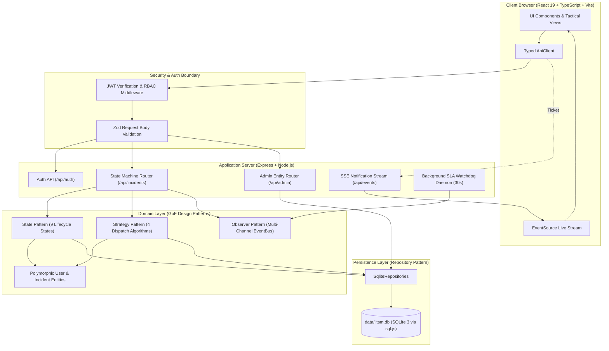

# I-ITSM System Architecture Specification

## 1. Architectural Overview

The Intelligent IT Service Management (I-ITSM) platform is architected as an enterprise-grade full-stack system combining an Object-Oriented Domain Layer, a persistent SQLite relational database, an Express application server with Server-Sent Events (SSE), and a modern React client with tactical mission-control visualization.

---

## 2. GoF Design Patterns Implementation

### A. State Pattern
- **Interfaces & Classes:** `IncidentState`, `BaseIncidentState`, `NewState`, `ClassifiedState`, `AssignedState`, `AcknowledgedState`, `InProgressState`, `NeedsInfoState`, `ResolvedState`, `VerifiedState`, `ClosedState`.
- **Purpose:** Programmatically enforces valid state transitions and rejects illegal jumps (e.g. `NEW` directly to `CLOSED`) by raising `InvalidStateTransitionException` which the server maps to HTTP 409 Conflict.

### B. Strategy Pattern
- **Interfaces & Classes:** `AssignmentStrategy`, `SkillBasedAssignmentStrategy`, `LoadBasedAssignmentStrategy`, `RoundRobinAssignmentStrategy`, `ExperienceBasedAssignmentStrategy`, `AssignmentStrategyContext`.
- **Purpose:** Enables runtime swapping of technician assignment algorithms. Dynamically evaluates operator workload capacities against incident complexity, category keywords, and service criticality.

### C. Observer Pattern
- **Interfaces & Classes:** `IncidentObserver`, `IncidentEventBus`, `InAppNotificationObserver`, `EmailNotificationAdapter`, `SmsNotificationAdapter`, `AuditObserver`.
- **Purpose:** Decouples event generation from delivery. When incidents transition, SLA thresholds are breached, or technicians are assigned, events are broadcast simultaneously to in-app notification logs, simulated email dispatches, high-priority SMS alerts, and immutable audit logs.

### D. Repository Pattern
- **Interfaces & Classes:** Generic `Repository<T, ID>`, implemented by `SqliteIncidentRepository`, `SqliteUserRepository`, `SqliteServiceRepository`, `SqliteCategoryRepository`, `SqliteSLAPolicyRepository`, `SqliteFeedbackRepository`, and `SqliteAuditRepository`.
- **Purpose:** Abstracts database persistence details away from domain logic, reading and writing relational tables in `data/iitsm.db`.

---

## 3. Server Execution Modes

1. **Development Mode (`npm run dev`)**:
   - `tsx src/server.ts` launches the Express server.
   - Vite is mounted directly into Express via `vite.middlewares` in development middleware mode on port 3000.
   - Hot module replacement (HMR) and on-the-fly TypeScript compilation occur without building to disk.
2. **Production Mode (`npm run build && npm start`)**:
   - `npm run build` bundles React client assets into `dist/`.
   - `npm start` runs `tsx src/server.ts`. Express detects `dist/index.html` and statically serves production assets with wildcard SPA fallback.
