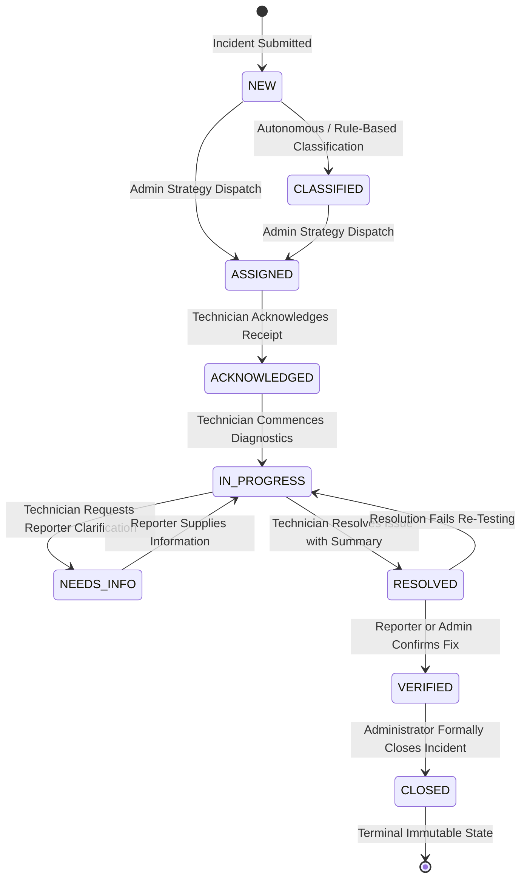

# I-ITSM Incident State Machine Specification

## 1. State Pattern Transition Rules

The I-ITSM system implements the GoF State Pattern across 9 discrete phases. Any transition not explicitly permitted below throws an `InvalidStateTransitionException` (mapped to HTTP 409 Conflict).

---

## 2. Permitted Transitions Matrix

| Current State | Permitted Next States | Authorized Roles | Triggering Action |
| :--- | :--- | :--- | :--- |
| **`NEW`** | `CLASSIFIED`, `ASSIGNED` | `ROLE_ADMIN`, System Classifier | `classify()`, `assign()` |
| **`CLASSIFIED`** | `ASSIGNED` | `ROLE_ADMIN` | `assignByAdmin()` |
| **`ASSIGNED`** | `ACKNOWLEDGED` | `ROLE_TECHNICIAN` (assigned tech only), `ROLE_ADMIN` | `acknowledgeByTechnician()` |
| **`ACKNOWLEDGED`** | `IN_PROGRESS` | `ROLE_TECHNICIAN` (assigned tech only), `ROLE_ADMIN` | `startProgress()` |
| **`IN_PROGRESS`** | `NEEDS_INFO`, `RESOLVED` | `ROLE_TECHNICIAN` (assigned tech only), `ROLE_ADMIN` | `requestInfo()`, `resolveIncident()` |
| **`NEEDS_INFO`** | `IN_PROGRESS` | `ROLE_TECHNICIAN`, `ROLE_EMPLOYEE` (reporter), `ROLE_ADMIN` | `startProgress()` |
| **`RESOLVED`** | `VERIFIED`, `IN_PROGRESS` | `ROLE_EMPLOYEE` (reporter only), `ROLE_ADMIN` | `verifyResolution()`, `reopen()` |
| **`VERIFIED`** | `CLOSED` | `ROLE_ADMIN` only | `closeIncident()` |
| **`CLOSED`** | None (Terminal) | None | Terminal state. No modifications allowed. |

---

## 3. Illegal Transition Guard Examples

- Direct jump `NEW` → `CLOSED`: **BLOCKED** with 409 `InvalidStateTransitionException`.
- Direct jump `NEW` → `RESOLVED`: **BLOCKED** (must proceed through `ASSIGNED` → `ACKNOWLEDGED` → `IN_PROGRESS`).
- Technician closing incident `VERIFIED` → `CLOSED`: **BLOCKED** with 403 `UnauthorizedOperationException` (only Administrator holds formal closure authority).
- Employee verifying un-resolved ticket `IN_PROGRESS` → `VERIFIED`: **BLOCKED** with 409 `InvalidStateTransitionException`.
