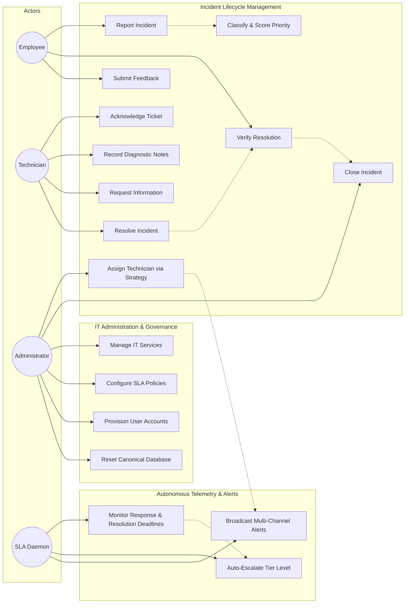

# I-ITSM Use Case Model

## 1. System Actors

- **Employee (`ROLE_EMPLOYEE`)**: Standard enterprise user who reports incidents, tracks personal tickets, receives resolution notices, verifies resolved tickets, and submits satisfaction feedback.
- **Technician (`ROLE_TECHNICIAN`)**: Operational engineer who investigates assigned incidents, acknowledges receipt, records diagnostic notes, requests additional information, and marks incidents as resolved.
- **Administrator (`ROLE_ADMIN`)**: IT operations lead who performs technician dispatch using GoF assignment strategies, closes verified incidents, manages IT service topology, configures categories and SLA policies, and provisions user accounts.
- **SLA Watchdog Daemon**: Background autonomous agent executing every 30 seconds to monitor elapsed SLA time, compute breach thresholds, trigger auto-escalations across 4 operational tiers, and dispatch emergency alerts.

---

## 2. Use Case Diagram

---

## 3. Key Use Case Specifications

### UC-1: Report Incident
- **Primary Actor:** Employee
- **Preconditions:** Authenticated session with `ROLE_EMPLOYEE` or `ROLE_ADMIN`.
- **Flow:**
  1. User fills in Title, Description, Affected Service, Category, Impact, and Urgency.
  2. System calculates Priority dynamically (Weighted Scoring or Rule-Based).
  3. System matches SLA Policy to compute Response and Resolution Deadlines.
  4. System runs Jaccard n-gram scan against existing open tickets to detect potential duplicates.
  5. Ticket created in `NEW` state; `INCIDENT_CREATED` event dispatched to event bus.

### UC-3: Assign Technician via Strategy Pattern
- **Primary Actor:** Administrator
- **Preconditions:** Incident in `NEW` or `CLASSIFIED` state.
- **Flow:**
  1. Admin selects one of four GoF Assignment Strategies (`SKILL_BASED`, `LOAD_BASED`, `ROUND_ROBIN`, `EXPERIENCE_BASED`).
  2. Strategy scans technician pool, filtering out engineers exceeding `maxWorkload`.
  3. Chosen technician assigned; incident transitions to `ASSIGNED`.
  4. Multi-channel observer notifies technician via In-App, Email, and SMS (if P1).

### UC-15: Monitor SLA Deadlines (Watchdog Daemon)
- **Primary Actor:** Autonomous Daemon (Background Process)
- **Trigger:** Time-based periodic trigger (every 30 seconds).
- **Flow:**
  1. Daemon loads all active incidents in non-terminal states.
  2. Compares `now` against `responseDeadline` and `resolutionDeadline`.
  3. If unacknowledged and deadline passed: marks `slaBreachedResponse = true`, escalates tier (`TECHNICIAN` → `TEAM_LEAD` → `SYSTEM_ADMIN` → `IT_MANAGER`), and logs audit entry.
  4. Dispatches `SLA_BREACHED` event across all channels.
